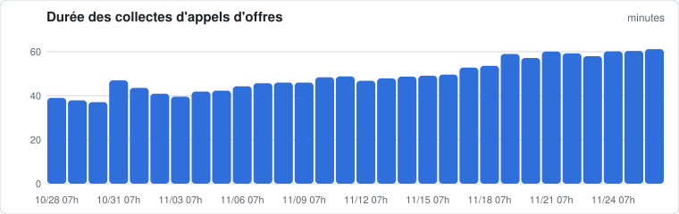
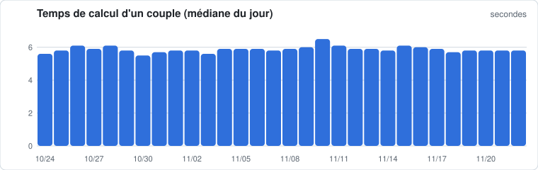

# Serveur du moteur V2

Mis à jour le 26/11/2026 à 17:00 · publication : **EN SERVICE (publie sur le site)**

## 🟢 **Tout va bien**

| Passe | Dernier résultat |
|---|---|
| Demandes des clients | 2026-11-26 16:59:03  connexion OK, 0 couple(s) en attente : aucun |
| Collecte des appels d'offres | 2026-11-26 07:31:13  OK, 719 avis collectés, 365 couples recalculés, 101 republiés en 61.2 min |
| Passe DECP hebdomadaire | 2026-11-21 04:33:49  Passe hebdomadaire DECP 2026-11-21_decp : terminée en 93.8 min, mémoire max 4287 Mo ; 360 couples recalculés, 1 bloqués par la garde (M01_58) ; 352 couples publiés, tables d'aide publiées |
| Contrôle quotidien | 2026-11-26 07:35:50  Contrôle du 26/11 : vert — 365 couples identiques au site ; tâches à l'heure, site à jour |

**Machine maintenant** : mémoire 0.48 Go sur 7.6 · charge 0.00 · disque 37.9 % · échange 0.0 Go

## Disque

Rythme des 14 derniers jours : +0.7 point(s) par semaine · 80 % dans **60.1 semaine(s)**

```
Mesure du 2026-11-26 05:45 :
  entrepot/sources                            3.57 Go
  entrepot/decp                               2.06 Go
  entrepot/boamp                              1.40 Go
  entrepot/passes                             1.23 Go
  production/controles                        0.72 Go
  entrepot/execution                          0.72 Go
  entrepot/marche                             0.26 Go
  production/publies                          0.24 Go
  entrepot/photographie                       0.23 Go
  entrepot/etiquettes                           38 Mo
  entrepot/referentiel                          16 Mo
  entrepot/avis                                  3 Mo
  logs                                           3 Mo
  production/(fichiers)                          3 Mo
  entrepot/sirene                                2 Mo
  entrepot/tmp                                   2 Mo
  entrepot/mesures.jsonl                         2 Mo
  production/rejeu                               0 Mo
  entrepot/sources_temoin.jsonl                  0 Mo
  entrepot/manifeste.json                        0 Mo
Croissance par dossier (depuis 2026-11-19, 7.0 j), en Go par semaine :
  entrepot/passes                               +0.04
  entrepot/decp                                 +0.03
  entrepot/sources                              +0.03
  production/controles                          +0.03
  entrepot/boamp                                +0.01
  entrepot/execution                            +0.01
Dernière purge (2026-11-26 05:45) : faite, 2 élément(s), 0.24 Go libérés · fusions 1 (0.0 Go) · photographies_controle 1 (0.24 Go)
```

## Performances






Les mesures d'avant la bascule viennent du PC ; celles d'après, du serveur.

### 10 dernières collectes

| Quand | Avis | Couples recalculés | Republiés | Échecs | Durée |
|---|---:|---:|---:|---:|---:|
| 26/11 07:31 | 719 | 365 | 101 | 0 | 61.2 min |
| 25/11 07:30 | 584 | 363 | 113 | 0 | 60.4 min |
| 24/11 07:30 | 586 | 363 | 114 | 0 | 60.2 min |
| 23/11 07:28 | 254 | 355 | 30 | 0 | 58.0 min |
| 22/11 07:29 | 692 | 361 | 100 | 0 | 59.3 min |
| 21/11 07:30 | 878 | 360 | 151 | 0 | 60.1 min |
| 20/11 07:27 | 337 | 343 | 91 | 0 | 57.2 min |
| 19/11 07:29 | 545 | 347 | 111 | 0 | 59.0 min |
| 18/11 07:23 | 362 | 310 | 87 | 0 | 53.6 min |
| 17/11 07:22 | 346 | 306 | 114 | 0 | 52.8 min |

### Passes DECP hebdomadaires

| Passe | Durée des couples | Mémoire max |
|---|---:|---:|
| 2026-11-21_decp | 59.9 min | 2890 Mo |
| 2026-11-14_decp | 50.5 min | 2828 Mo |
| 2026-11-07_decp | 55.7 min | 2686 Mo |
| 2026-10-31_decp | 53.2 min | 2538 Mo |
| 2026-10-24_decp | 33.0 min | 2373 Mo |
| 2026-10-17_decp | 41.8 min | — Mo |

### Demandes des clients aujourd'hui

Aucune pour l'instant.

### Contrôles quotidiens (14 derniers)

```
2026-11-13 07:21  Contrôle du 13/11 : vert — 266 couples identiques au site ; tâches à l'heure, site à jour
2026-11-14 07:31  Contrôle du 14/11 : vert — 266 couples identiques au site ; tâches à l'heure, site à jour
2026-11-15 07:23  Contrôle du 15/11 : vert — 266 couples identiques au site ; tâches à l'heure, site à jour
2026-11-16 07:23  Contrôle du 16/11 : vert — 276 couples identiques au site ; tâches à l'heure, site à jour
2026-11-17 07:26  Contrôle du 17/11 : vert — 318 couples identiques au site ; tâches à l'heure, site à jour
2026-11-18 07:27  Contrôle du 18/11 : vert — 319 couples identiques au site ; tâches à l'heure, site à jour
2026-11-19 07:33  Contrôle du 19/11 : vert — 347 couples identiques au site ; tâches à l'heure, site à jour
2026-11-20 07:31  Contrôle du 20/11 : rouge — 347 couples identiques au site ; tâches à l'heure, site à jour ; CHUTES : C713_75 : opportunites 34 → 16
2026-11-21 07:34  Contrôle du 21/11 : vert — 360 couples identiques au site ; tâches à l'heure, site à jour
2026-11-22 07:33  Contrôle du 22/11 : vert — 361 couples identiques au site ; tâches à l'heure, site à jour
2026-11-23 07:32  Contrôle du 23/11 : vert — 361 couples identiques au site ; tâches à l'heure, site à jour
2026-11-24 07:34  Contrôle du 24/11 : vert — 363 couples identiques au site ; tâches à l'heure, site à jour
2026-11-25 07:34  Contrôle du 25/11 : vert — 363 couples identiques au site ; tâches à l'heure, site à jour
2026-11-26 07:35  Contrôle du 26/11 : vert — 365 couples identiques au site ; tâches à l'heure, site à jour
```

## Tâches planifiées
```
NEXT                            LEFT LAST                         PASSED UNIT                     ACTIVATES
Fri 2026-11-27 05:45:00 CET      12h Thu 2026-11-26 05:45:01 CET 11h ago tenderhit-purge.timer    tenderhit-purge.service
Fri 2026-11-27 06:30:00 CET      13h Thu 2026-11-26 06:30:01 CET 10h ago tenderhit-collecte.timer tenderhit-collecte.service
Sat 2026-11-28 03:00:00 CET 1 day 9h Sat 2026-11-21 03:00:00 CET       - tenderhit-hebdo.timer    tenderhit-hebdo.service
-                                  - Thu 2026-11-26 17:00:01 CET  1s ago tenderhit-demandes.timer tenderhit-demandes.service
-                                  - Thu 2026-11-26 17:00:01 CET  1s ago tenderhit-relais.timer   tenderhit-relais.service

5 timers listed.
```

## Fin du journal du moteur
```
2026-11-26 13:40:07  contrats_envoi (commande) : {"cites": 9, "trouves": 9, "envoyes": 9, "retires": 0, "paquets": 1}
2026-11-26 13:42:08    contrats des chaînes : 9 envoyé(s), 0 retiré(s), 9 cité(s) au total
2026-11-26 13:42:08  contrats_envoi (commande) : {"cites": 9, "trouves": 9, "envoyes": 9, "retires": 0, "paquets": 1}
2026-11-26 15:00:53  retrait DCE (retraits) impossible : dce_en_attente : ReadTimeout : HTTPSConnectionPool(host='tenhit.fr', port=443): Read timed out. (read timeout=30)
2026-11-26 15:03:15  retrait DCE (retraits) impossible : dce_en_attente : ReadTimeout : HTTPSConnectionPool(host='tenhit.fr', port=443): Read timed out. (read timeout=30)
2026-11-26 15:25:48  retrait DCE (retraits) impossible : dce_en_attente : ReadTimeout : HTTPSConnectionPool(host='tenhit.fr', port=443): Read timed out. (read timeout=30)
2026-11-26 15:27:05  contrats : 1606315 contrats préparés en 42 s
2026-11-26 15:28:14  contrats : chaînage, 500000 contrats lus (68 s)
2026-11-26 15:28:43  contrats : chaînage, 1000000 contrats lus (97 s)
2026-11-26 15:30:37  contrats : chaînage, 1500000 contrats lus (211 s)
2026-11-26 15:31:12  contrats : 1606315 contrats (294454 doublons fusionnés), chaînage {'aucun': 1232919, 'probable': 186255, 'sur': 187141} en 287.8 s
2026-11-26 15:34:05  publier M12_93 : sortant par le chaînage (cette commande seulement)
2026-11-26 15:34:15  M12_93 republié : 28 opportunités, attributions anciennes retirées : None (9 s)
2026-11-26 15:36:08    contrats des chaînes : 2 envoyé(s), 0 retiré(s), 10 cité(s) au total
2026-11-26 15:36:08  contrats_envoi (commande) : {"cites": 10, "trouves": 10, "envoyes": 2, "retires": 0, "paquets": 1}
2026-11-26 15:50:05  publier C772_38 C772_42 M12_43 M12_63 M12_69 M12_74 M12_83 M29_38 M29_83 M29_93 : sortant par le chaînage (cette commande seulement)
2026-11-26 15:50:14  C772_38 republié : 5 opportunités, attributions anciennes retirées : None (8 s)
2026-11-26 15:50:21  C772_42 republié : 4 opportunités, attributions anciennes retirées : None (8 s)
2026-11-26 15:50:38  M12_43 republié : 2 opportunités, attributions anciennes retirées : None (17 s)
2026-11-26 15:50:45  M12_63 republié : 4 opportunités, attributions anciennes retirées : None (7 s)
2026-11-26 15:50:53  M12_69 republié : 27 opportunités, attributions anciennes retirées : None (8 s)
2026-11-26 15:50:59  M12_74 republié : 9 opportunités, attributions anciennes retirées : None (6 s)
2026-11-26 15:51:06  M12_83 republié : 14 opportunités, attributions anciennes retirées : None (7 s)
2026-11-26 15:51:26  M29_38 republié : 1 opportunités, attributions anciennes retirées : None (20 s)
2026-11-26 15:51:44  M29_83 republié : 1 opportunités, attributions anciennes retirées : None (18 s)
2026-11-26 15:52:08  M29_93 republié : 2 opportunités, attributions anciennes retirées : None (24 s)
2026-11-26 15:52:13    contrats des chaînes : 3 envoyé(s), 0 retiré(s), 13 cité(s) au total
2026-11-26 15:52:13  contrats_envoi (commande) : {"cites": 13, "trouves": 13, "envoyes": 3, "retires": 0, "paquets": 1}
2026-11-26 15:56:53  retrait DCE (retraits) impossible : dce_en_attente : ReadTimeout : HTTPSConnectionPool(host='tenhit.fr', port=443): Read timed out. (read timeout=30)
2026-11-26 16:15:39  retrait DCE (retraits) impossible : dce_en_attente : ReadTimeout : HTTPSConnectionPool(host='tenhit.fr', port=443): Read timed out. (read timeout=30)
2026-11-26 16:17:27  retrait DCE (retraits) impossible : dce_en_attente : ReadTimeout : HTTPSConnectionPool(host='tenhit.fr', port=443): Read timed out. (read timeout=30)
2026-11-26 16:19:49  retrait DCE (retraits) impossible : dce_en_attente : ReadTimeout : HTTPSConnectionPool(host='tenhit.fr', port=443): Read timed out. (read timeout=30)
2026-11-26 16:22:12  retrait DCE (retraits) impossible : dce_en_attente : ReadTimeout : HTTPSConnectionPool(host='tenhit.fr', port=443): Read timed out. (read timeout=30)
2026-11-26 16:24:34  retrait DCE (retraits) impossible : dce_en_attente : ReadTimeout : HTTPSConnectionPool(host='tenhit.fr', port=443): Read timed out. (read timeout=30)
2026-11-26 16:26:56  retrait DCE (retraits) impossible : dce_en_attente : ReadTimeout : HTTPSConnectionPool(host='tenhit.fr', port=443): Read timed out. (read timeout=30)
2026-11-26 16:29:19  retrait DCE (retraits) impossible : dce_en_attente : ReadTimeout : HTTPSConnectionPool(host='tenhit.fr', port=443): Read timed out. (read timeout=30)
2026-11-26 16:31:41  retrait DCE (retraits) impossible : dce_en_attente : ReadTimeout : HTTPSConnectionPool(host='tenhit.fr', port=443): Read timed out. (read timeout=30)
2026-11-26 16:34:03  retrait DCE (retraits) impossible : dce_en_attente : ReadTimeout : HTTPSConnectionPool(host='tenhit.fr', port=443): Read timed out. (read timeout=30)
2026-11-26 16:36:26  retrait DCE (retraits) impossible : dce_en_attente : ReadTimeout : HTTPSConnectionPool(host='tenhit.fr', port=443): Read timed out. (read timeout=30)
2026-11-26 16:38:48  retrait DCE (retraits) impossible : dce_en_attente : ReadTimeout : HTTPSConnectionPool(host='tenhit.fr', port=443): Read timed out. (read timeout=30)
```
