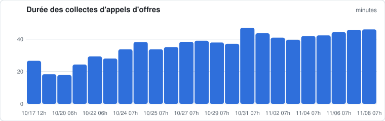
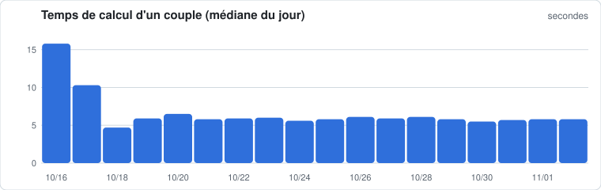
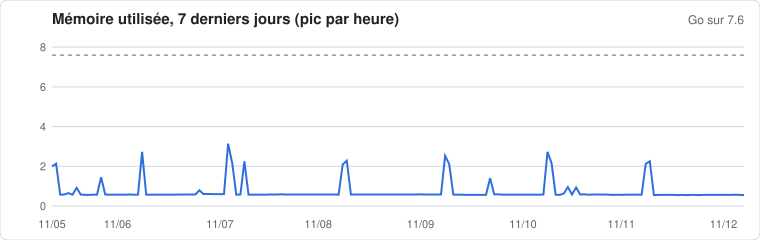

# Serveur du moteur V2

Mis à jour le 03/11/2026 à 17:00 · publication : **EN SERVICE (publie sur le site)**

## 🟢 **Tout va bien**

| Passe | Dernier résultat |
|---|---|
| Demandes des clients | 2026-11-03 17:00:05  connexion OK, 0 couple(s) en attente : aucun |
| Collecte des appels d'offres | 2026-11-03 07:09:40  OK, 315 avis collectés, 219 couples recalculés, 79 republiés en 39.6 min |
| Passe DECP hebdomadaire | 2026-11-03 16:10:45  Passe hebdomadaire DECP 2026-10-31_decp : terminée en 102.1 min, mémoire max 5747 Mo ; 219 couples recalculés, 0 bloqués par la garde ; 215 couples publiés, tables d'aide publiées |
| Contrôle quotidien | 2026-11-03 07:12:57  Contrôle du 03/11 : vert — 219 couples identiques au site, 349 attributions anciennes gardées par le site ; tâches à l'heure, site à jour |

**Machine maintenant** : mémoire 0.55 Go sur 7.6 · charge 0.00 · disque 32.2 % · échange 0.0 Go

## Performances







Les mesures d'avant la bascule viennent du PC ; celles d'après, du serveur.

### 10 dernières collectes

| Quand | Avis | Couples recalculés | Republiés | Échecs | Durée |
|---|---:|---:|---:|---:|---:|
| 03/11 07:09 | 315 | 219 | 79 | 0 | 39.6 min |
| 02/11 07:10 | 251 | 219 | 42 | 0 | 40.9 min |
| 01/11 07:13 | 543 | 219 | 219 | 0 | 43.6 min |
| 31/10 07:17 | 410 | 213 | 44 | 0 | 47.0 min |
| 30/10 07:07 | 695 | 172 | 55 | 0 | 37.1 min |
| 29/10 07:07 | 704 | 172 | 51 | 1 | 37.9 min |
| 28/10 07:09 | 640 | 166 | 62 | 0 | 39.0 min |
| 27/10 07:08 | 351 | 161 | 63 | 0 | 38.3 min |
| 26/10 07:05 | 533 | 163 | 49 | 0 | 35.1 min |
| 25/10 07:03 | 138 | 160 | 15 | 0 | 33.7 min |

### Passes DECP hebdomadaires

| Passe | Durée des couples | Mémoire max |
|---|---:|---:|
| 2026-10-31_decp | 53.2 min | 2538 Mo |
| 2026-10-24_decp | 33.0 min | 2373 Mo |
| 2026-10-17_decp | 41.8 min | — Mo |
| essai_pc | 26.3 min | 1616 Mo |
| essai_2026-10-16 | 26.4 min | 1950 Mo |
| essai_2026-10-16 | 25.6 min | 1950 Mo |

### Demandes des clients aujourd'hui

Aucune pour l'instant.

### Contrôles quotidiens (14 derniers)

```
2026-10-22 07:05  Contrôle du 22/10 : rouge — 157 couples identiques au site, 2 pas encore republiés par le V2, 124 attributions anciennes gardées par le site ; EN ÉCART : M04_62 ; tâches à l'heure, site à jour
2026-10-23 07:03  Contrôle du 23/10 : rouge — 157 couples identiques au site, 2 pas encore republiés par le V2, 124 attributions anciennes gardées par le site ; EN ÉCART : M04_62 ; tâches à l'heure, site à jour
2026-10-24 07:06  Contrôle du 24/10 : rouge — 47 couples identiques au site, 175 attributions anciennes gardées par le site ; EN ÉCART : C093_69, C093_75, C451_01, C451_26, C451_38, C451_69, C451_71, C451_74, C451_FR, C642_FR, C710_14, C710_22, C710_27, C710_29, C710_35, C710_56, C710_59, C710_60, C710_75, C710_76, C710_80, C710_93, C715_04, C715_05, C715_06, C715_13, C715_75, C715_83, C715_84, C728_69, C728_75, C741_14, C741_22, C741_27, C741_29, C741_35, C741_56, C741_59, C741_60, C741_75, C741_76, C741_80, C741_93, C772_01, C772_26, C772_38, C772_69, C772_71, C772_74, C772_FR, C794_FR, C805_34, M01_01, M01_14, M01_16, M01_24, M01_38, M01_59, M01_69, M01_73, M01_74, M01_75, M01_76, M01_83, M01_92, M01_93, M01_94, M01_FR, M03_76, M04_62, M04_76, M07_59, M07_76, M08_76, M08_81, M22_05, M22_07, M22_16, M22_17, M22_21, M22_24, M22_74, M22_75, M22_83, M22_87, M22_92, M22_93, M23_27, M23_44, M23_76, M24_69, M24_76, M30_69, M33_01, M33_38, M33_42, M33_69, M33_71, M33_85, M40_05, M40_76, P1005_14, P1005_22, P1005_27, P1005_29, P1005_35, P1005_56, P1005_59, P1005_60, P1005_75, P1005_76, P1005_80, P1005_93 ; tâches à l'heure, site à jour
2026-10-25 07:08  Contrôle du 25/10 : vert — 160 couples identiques au site ; tâches à l'heure, site à jour
2026-10-26 07:09  Contrôle du 26/10 : vert — 163 couples identiques au site ; tâches à l'heure, site à jour
2026-10-27 07:13  Contrôle du 27/10 : vert — 166 couples identiques au site, 10 attributions anciennes gardées par le site ; tâches à l'heure, site à jour
2026-10-28 07:14  Contrôle du 28/10 : vert — 166 couples identiques au site, 10 attributions anciennes gardées par le site ; tâches à l'heure, site à jour
2026-10-29 07:13  Contrôle du 29/10 : rouge — 171 couples identiques au site, 10 attributions anciennes gardées par le site ; EN ÉCART : C713_FR ; collecte du matin : 2026-10-29 07:07:57  1 ÉCHEC(S), 704 avis collectés, 172 couples recalculés, 51 republiés en 37.9 min
2026-10-30 07:12  Contrôle du 30/10 : vert — 172 couples identiques au site, 10 attributions anciennes gardées par le site ; tâches à l'heure, site à jour
2026-10-31 07:20  Contrôle du 31/10 : rouge — 215 couples identiques au site, 349 attributions anciennes gardées par le site ; EN ÉCART : M01_04, M01_27, M01_63, M01_71 ; tâches à l'heure, site à jour
2026-10-31 11:33  Contrôle du 31/10 : vert — 219 couples identiques au site, 349 attributions anciennes gardées par le site ; tâches à l'heure, site à jour
2026-11-01 07:17  Contrôle du 01/11 : vert — 219 couples identiques au site, 349 attributions anciennes gardées par le site ; tâches à l'heure, site à jour
2026-11-02 07:14  Contrôle du 02/11 : vert — 219 couples identiques au site, 349 attributions anciennes gardées par le site ; tâches à l'heure, site à jour
2026-11-03 07:12  Contrôle du 03/11 : vert — 219 couples identiques au site, 349 attributions anciennes gardées par le site ; tâches à l'heure, site à jour
```

## Tâches planifiées
```
NEXT                          LEFT LAST                            PASSED UNIT                     ACTIVATES
Wed 2026-11-04 06:30:00 CET    13h Tue 2026-11-03 06:30:04 CET    10h ago tenderhit-collecte.timer tenderhit-collecte.service
Sat 2026-11-07 03:00:00 CET 3 days Sat 2026-10-31 03:00:04 CET 3 days ago tenderhit-hebdo.timer    tenderhit-hebdo.service
-                                - Tue 2026-11-03 17:00:04 CET     1s ago tenderhit-demandes.timer tenderhit-demandes.service
-                                - Tue 2026-11-03 17:00:04 CET     1s ago tenderhit-relais.timer   tenderhit-relais.service

4 timers listed.
```

## Fin du journal du moteur
```
2026-11-03 06:59:43    M22_91 : 3 opportunités · rapport et opportunités · 7 s
2026-11-03 06:59:51    M22_92 : 8 opportunités · rapport et opportunités · 8 s
2026-11-03 06:59:59    M22_93 : 2 opportunités · rapport et opportunités · 8 s
2026-11-03 07:00:05    M22_94 : 7 opportunités · inchangé · 7 s
2026-11-03 07:00:31    M22_95 : 6 opportunités · rapport et opportunités · 25 s
2026-11-03 07:00:36    M23_27 : 5 opportunités · inchangé · 6 s
2026-11-03 07:00:47    M23_44 : 7 opportunités · rapport et opportunités · 11 s
2026-11-03 07:01:00    M23_76 : 7 opportunités · rapport et opportunités · 13 s
2026-11-03 07:01:11    M24_69 : 9 opportunités · rapport et opportunités · 11 s
2026-11-03 07:01:20    M24_76 : 9 opportunités · rapport et opportunités · 9 s
2026-11-03 07:01:29    M30_69 : 14 opportunités · inchangé · 9 s
2026-11-03 07:01:31    M33_01 : 3 opportunités · inchangé · 3 s
2026-11-03 07:01:38    M33_14 : 6 opportunités · inchangé · 6 s
2026-11-03 07:01:44    M33_27 : 3 opportunités · inchangé · 6 s
2026-11-03 07:01:52    M33_38 : 9 opportunités · rapport et opportunités · 9 s
2026-11-03 07:01:58    M33_42 : 1 opportunités · inchangé · 6 s
2026-11-03 07:02:05    M33_50 : 4 opportunités · rapport et opportunités · 7 s
2026-11-03 07:02:10    M33_61 : 2 opportunités · inchangé · 5 s
2026-11-03 07:02:21    M33_69 : 18 opportunités · rapport et opportunités · 11 s
2026-11-03 07:02:28    M33_71 : 9 opportunités · rapport et opportunités · 7 s
2026-11-03 07:02:36    M33_76 : 15 opportunités · rapport et opportunités · 8 s
2026-11-03 07:02:44    M33_85 : 5 opportunités · rapport et opportunités · 8 s
2026-11-03 07:07:03    M33_FR : 551 opportunités · rapport et opportunités · 259 s
2026-11-03 07:07:14    M40_05 : 0 opportunités · rapport et opportunités · 11 s
2026-11-03 07:07:21    M40_76 : 2 opportunités · inchangé · 6 s
2026-11-03 07:07:30    P1005_14 : 0 opportunités · rapport et opportunités · 10 s
2026-11-03 07:07:39    P1005_22 : 9 opportunités · rapport et opportunités · 9 s
2026-11-03 07:07:47    P1005_27 : 4 opportunités · inchangé · 8 s
2026-11-03 07:07:57    P1005_29 : 15 opportunités · rapport et opportunités · 10 s
2026-11-03 07:08:09    P1005_35 : 21 opportunités · rapport et opportunités · 12 s
2026-11-03 07:08:18    P1005_56 : 11 opportunités · inchangé · 9 s
2026-11-03 07:08:33    P1005_59 : 20 opportunités · rapport et opportunités · 16 s
2026-11-03 07:08:42    P1005_60 : 3 opportunités · inchangé · 9 s
2026-11-03 07:09:07    P1005_75 : 45 opportunités · rapport et opportunités · 24 s
2026-11-03 07:09:18    P1005_76 : 7 opportunités · rapport et opportunités · 3 identifiants DECP raccourcis · 12 s
2026-11-03 07:09:27    P1005_80 : 0 opportunités · inchangé · 9 s
2026-11-03 07:09:40    P1005_93 : 13 opportunités · rapport et opportunités · 13 s
2026-11-03 07:09:40  OK, 315 avis collectés, 219 couples recalculés, 79 republiés en 39.6 min
2026-11-03 07:12:57  Contrôle du 03/11 : vert — 219 couples identiques au site, 349 attributions anciennes gardées par le site ; tâches à l'heure, site à jour
2026-11-03 16:10:45  Passe hebdomadaire DECP 2026-10-31_decp : terminée en 102.1 min, mémoire max 5747 Mo ; 219 couples recalculés, 0 bloqués par la garde ; 215 couples publiés, tables d'aide publiées
```
