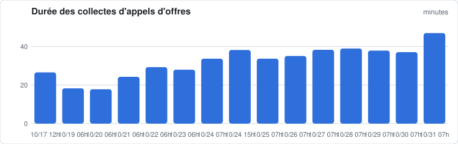
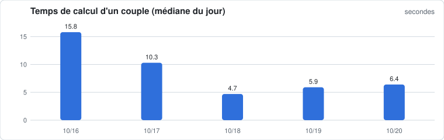
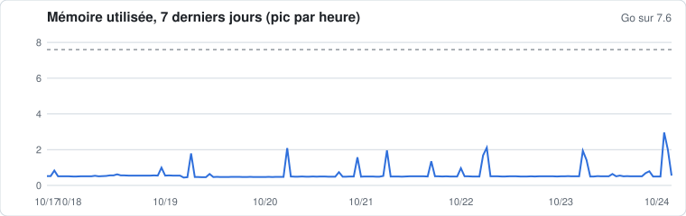

# Serveur du moteur V2

Mis à jour le 19/10/2026 à 10:00 · publication : **EN SERVICE (publie sur le site)**

## 🔴 **À regarder** : contrôle quotidien rouge

| Passe | Dernier résultat |
|---|---|
| Demandes des clients | 2026-10-19 09:59:06  connexion OK, 0 couple(s) en attente : aucun |
| Collecte des appels d'offres | 2026-10-19 06:48:22  OK, 540 avis collectés, 89 couples recalculés, 81 republiés en 18.3 min |
| Passe DECP hebdomadaire | 2026-10-17 16:00:21  Passe hebdomadaire DECP 2026-10-17_decp : terminée en 69.6 min, mémoire max 0 Mo ; 92 couples recalculés, 2 bloqués par la garde (M22_05, M22_07) ; 88 couples publiés, tables d'aide publiées |
| Contrôle quotidien | 2026-10-19 06:49:35  Contrôle du 19/10 : rouge — 96 couples identiques au site, 2 pas encore republiés par le V2, 124 attributions anciennes gardées par le site ; EN ÉCART : C712_69, C712_74, C713_69, C713_74, C713_75, C713_FR, C715_69, C715_74 ; demandes : dernière passe il y a 19 min (attendu : toutes les minutes) |

**Machine maintenant** : mémoire 0.45 Go sur 7.6 · charge 0.00 · disque 21.6 % · échange 0.0 Go

## Performances







Les mesures d'avant la bascule viennent du PC ; celles d'après, du serveur.

### 10 dernières collectes

| Quand | Avis | Couples recalculés | Republiés | Échecs | Durée |
|---|---:|---:|---:|---:|---:|
| 19/10 06:48 | 540 | 89 | 81 | 0 | 18.3 min |
| 17/10 12:47 | 1148 | 73 | 73 | 0 | 26.6 min |

### Passes DECP hebdomadaires

| Passe | Durée des couples | Mémoire max |
|---|---:|---:|
| 2026-10-17_decp | 41.8 min | — Mo |
| essai_pc | 26.3 min | 1616 Mo |
| essai_2026-10-16 | 26.4 min | 1950 Mo |
| essai_2026-10-16 | 25.6 min | 1950 Mo |
| essai_2026-10-16 | 23.9 min | 1950 Mo |
| essai_2026-10-16 | 21.9 min | 1950 Mo |

### Demandes des clients aujourd'hui

- 00:02 : (édition 2026-10, 366 opportunités, 1 demande(s) livrée(s), attributions anciennes retirées : non fait (identifiant de plus de 300 caractères dans la DECP)) en 132 s
- 09:06 : (édition 2026-10, 0 opportunités, 1 demande(s) livrée(s), attributions anciennes retirées : None) en 8 s
- 09:06 : (édition 2026-10, 3 opportunités, 1 demande(s) livrée(s), attributions anciennes retirées : None) en 8 s
- 09:06 : (édition 2026-10, 28 opportunités, 1 demande(s) livrée(s), attributions anciennes retirées : None) en 8 s
- 09:06 : (édition 2026-10, 9 opportunités, 1 demande(s) livrée(s), attributions anciennes retirées : None) en 7 s

### Contrôles quotidiens (14 derniers)

```
2026-10-19 06:49  Contrôle du 19/10 : rouge — 96 couples identiques au site, 2 pas encore republiés par le V2, 124 attributions anciennes gardées par le site ; EN ÉCART : C712_69, C712_74, C713_69, C713_74, C713_75, C713_FR, C715_69, C715_74 ; demandes : dernière passe il y a 19 min (attendu : toutes les minutes)
```

## Tâches planifiées
```
NEXT                           LEFT LAST                               PASSED UNIT                     ACTIVATES
Tue 2026-10-20 06:30:00 CEST    20h Mon 2026-10-19 06:30:04 CEST 3h 30min ago tenderhit-collecte.timer tenderhit-collecte.service
Sat 2026-10-24 03:00:00 CEST 4 days Sun 2026-10-18 10:14:39 CEST            - tenderhit-hebdo.timer    tenderhit-hebdo.service
-                                 - Mon 2026-10-19 10:00:04 CEST       1s ago tenderhit-demandes.timer tenderhit-demandes.service
-                                 - Mon 2026-10-19 10:00:04 CEST       1s ago tenderhit-relais.timer   tenderhit-relais.service

4 timers listed.
```

## Fin du journal du moteur
```
2026-10-19 06:44:23    M04_76 : 12 opportunités · rapport et opportunités · 5 s
2026-10-19 06:44:29    M07_59 : 38 opportunités · opportunités · 6 s
2026-10-19 06:44:34    M07_76 : 13 opportunités · opportunités · 5 s
2026-10-19 06:44:38    M08_76 : 13 opportunités · opportunités · 4 s
2026-10-19 06:44:45    M08_81 : 1 opportunités · opportunités · 7 s
2026-10-19 06:44:58    M22_16 : 1 opportunités · rapport et opportunités · 13 s
2026-10-19 06:45:11    M22_17 : 1 opportunités · rapport et opportunités · 13 s
2026-10-19 06:45:22    M22_21 : 0 opportunités · inchangé · 10 s
2026-10-19 06:45:35    M22_24 : 0 opportunités · rapport et opportunités · 13 s
2026-10-19 06:45:47    M22_27 : 0 opportunités · rapport et opportunités · 12 s
2026-10-19 06:45:53    M22_74 : 3 opportunités · rapport et opportunités · 6 s
2026-10-19 06:46:03    M22_75 : 22 opportunités · rapport et opportunités · 9 s
2026-10-19 06:46:16    M22_76 : 8 opportunités · rapport et opportunités · 13 s
2026-10-19 06:46:23    M22_83 : 6 opportunités · rapport et opportunités · 7 s
2026-10-19 06:46:37    M22_87 : 1 opportunités · rapport et opportunités · 14 s
2026-10-19 06:46:43    M22_92 : 16 opportunités · opportunités · 6 s
2026-10-19 06:46:49    M22_93 : 8 opportunités · opportunités · 6 s
2026-10-19 06:46:55    M22_94 : 11 opportunités · opportunités · 6 s
2026-10-19 06:47:02    M23_27 : 0 opportunités · rapport et opportunités · 6 s
2026-10-19 06:47:09    M23_44 : 3 opportunités · rapport et opportunités · 8 s
2026-10-19 06:47:17    M23_76 : 2 opportunités · opportunités · 8 s
2026-10-19 06:47:26    M24_69 : 2 opportunités · opportunités · 8 s
2026-10-19 06:47:33    M24_76 : 4 opportunités · opportunités · 7 s
2026-10-19 06:47:41    M30_69 : 2 opportunités · opportunités · 8 s
2026-10-19 06:47:48    M33_38 : 4 opportunités · opportunités · 7 s
2026-10-19 06:47:54    M33_42 : 1 opportunités · rapport et opportunités · 6 s
2026-10-19 06:48:03    M33_69 : 5 opportunités · opportunités · 9 s
2026-10-19 06:48:09    M33_71 : 0 opportunités · rapport et opportunités · 6 s
2026-10-19 06:48:16    M33_85 : 1 opportunités · opportunités · 6 s
2026-10-19 06:48:22    M40_76 : 1 opportunités · opportunités · 6 s
2026-10-19 06:48:22  OK, 540 avis collectés, 89 couples recalculés, 81 republiés en 18.3 min
2026-10-19 06:49:35  Contrôle du 19/10 : rouge — 96 couples identiques au site, 2 pas encore republiés par le V2, 124 attributions anciennes gardées par le site ; EN ÉCART : C712_69, C712_74, C713_69, C713_74, C713_75, C713_FR, C715_69, C715_74 ; demandes : dernière passe il y a 19 min (attendu : toutes les minutes)
2026-10-19 09:06:06  C451_42 : demande en attente
2026-10-19 09:06:14    publié (édition 2026-10, 0 opportunités, 1 demande(s) livrée(s), attributions anciennes retirées : None) en 8 s
2026-10-19 09:06:15  C772_42 : demande en attente
2026-10-19 09:06:23    publié (édition 2026-10, 3 opportunités, 1 demande(s) livrée(s), attributions anciennes retirées : None) en 8 s
2026-10-19 09:06:23  M01_42 : demande en attente
2026-10-19 09:06:31    publié (édition 2026-10, 28 opportunités, 1 demande(s) livrée(s), attributions anciennes retirées : None) en 8 s
2026-10-19 09:06:31  M01_71 : demande en attente
2026-10-19 09:06:38    publié (édition 2026-10, 9 opportunités, 1 demande(s) livrée(s), attributions anciennes retirées : None) en 7 s
```
