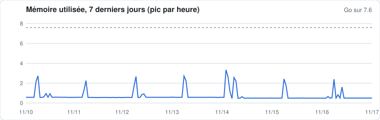

# Serveur du moteur V2

Mis à jour le 21/11/2026 à 04:00 · publication : **EN SERVICE (publie sur le site)**

## 🔴 **À regarder** : demandes des clients non traitées depuis plus de 15 min

| Passe | Dernier résultat |
|---|---|
| Demandes des clients | 2026-11-21 02:59:03  connexion OK, 0 couple(s) en attente : aucun |
| Collecte des appels d'offres | 2026-11-20 07:27:12  OK, 337 avis collectés, 343 couples recalculés, 91 republiés en 57.2 min |
| Passe DECP hebdomadaire | 2026-11-14 04:22:58  Passe hebdomadaire DECP 2026-11-14_decp : terminée en 82.9 min, mémoire max 4234 Mo ; 266 couples recalculés, 0 bloqués par la garde ; 260 couples publiés, tables d'aide publiées |
| Contrôle quotidien | 2026-11-20 07:31:39  Contrôle du 20/11 : rouge — 347 couples identiques au site ; tâches à l'heure, site à jour ; CHUTES : C713_75 : opportunites 34 → 16 |

**Machine maintenant** : mémoire 1.43 Go sur 7.6 · charge 1.64 · disque 38.2 % · échange 0.0 Go

## Disque

Rythme des 14 derniers jours : +0.5 point(s) par semaine · 80 % dans **92.9 semaine(s)**

```
Mesure du 2026-11-20 05:45 :
  entrepot/sources                            3.54 Go
  entrepot/decp                               2.02 Go
  entrepot/boamp                              1.39 Go
  entrepot/passes                             1.19 Go
  entrepot/execution                          0.70 Go
  production/controles                        0.70 Go
  entrepot/marche                             0.26 Go
  production/publies                          0.23 Go
  entrepot/photographie                       0.23 Go
  entrepot/etiquettes                           38 Mo
  entrepot/referentiel                          16 Mo
  entrepot/avis                                  3 Mo
  logs                                           3 Mo
  entrepot/sirene                                2 Mo
  production/(fichiers)                          2 Mo
  entrepot/tmp                                   2 Mo
  entrepot/mesures.jsonl                         1 Mo
  production/rejeu                               0 Mo
  entrepot/sources_temoin.jsonl                  0 Mo
  entrepot/manifeste.json                        0 Mo
Croissance par dossier (depuis 2026-11-12, 8.0 j), en Go par semaine :
  entrepot/decp                                 +0.37
  entrepot/passes                               +0.26
  entrepot/execution                            +0.06
  entrepot/sources                              +0.03
  production/publies                            +0.03
  entrepot/boamp                                +0.01
Dernière purge (2026-11-20 05:45) : faite, 2 élément(s), 0.23 Go libérés · fusions 1 (0.0 Go) · photographies_controle 1 (0.23 Go)
```

## Performances




Les mesures d'avant la bascule viennent du PC ; celles d'après, du serveur.

### 10 dernières collectes

| Quand | Avis | Couples recalculés | Republiés | Échecs | Durée |
|---|---:|---:|---:|---:|---:|
| 20/11 07:27 | 337 | 343 | 91 | 0 | 57.2 min |
| 19/11 07:29 | 545 | 347 | 111 | 0 | 59.0 min |
| 18/11 07:23 | 362 | 310 | 87 | 0 | 53.6 min |
| 17/11 07:22 | 346 | 306 | 114 | 0 | 52.8 min |
| 16/11 07:19 | 306 | 270 | 61 | 0 | 49.6 min |
| 15/11 07:19 | 430 | 266 | 59 | 0 | 49.1 min |
| 14/11 07:27 | 335 | 266 | 49 | 0 | 48.7 min |
| 13/11 07:17 | 471 | 260 | 60 | 0 | 47.9 min |
| 12/11 07:16 | 433 | 249 | 38 | 0 | 46.8 min |
| 11/11 07:18 | 647 | 249 | 176 | 0 | 48.8 min |

### Passes DECP hebdomadaires

| Passe | Durée des couples | Mémoire max |
|---|---:|---:|
| 2026-11-14_decp | 50.5 min | 2828 Mo |
| 2026-11-07_decp | 55.7 min | 2686 Mo |
| 2026-10-31_decp | 53.2 min | 2538 Mo |
| 2026-10-24_decp | 33.0 min | 2373 Mo |
| 2026-10-17_decp | 41.8 min | — Mo |
| essai_pc | 26.3 min | 1616 Mo |

### Demandes des clients aujourd'hui

Aucune pour l'instant.

### Contrôles quotidiens (14 derniers)

```
2026-11-09 07:18  Contrôle du 09/11 : rouge — 222 couples identiques au site, 369 attributions anciennes gardées par le site ; EN ÉCART : C093_69, C093_75, C451_01, C451_03, C451_07, C451_15, C451_21, C451_25, C451_26, C451_38, C451_39, C451_42, C451_43, C451_58 ; tâches à l'heure, site à jour
2026-11-10 07:21  Contrôle du 10/11 : rouge — 235 couples identiques au site, 369 attributions anciennes gardées par le site ; EN ÉCART : C093_69, C093_75, C451_01, C451_03, C451_07, C451_15, C451_21, C451_25, C451_26, C451_38, C451_39, C451_42, C451_43, C451_58 ; tâches à l'heure, site à jour
2026-11-10 11:59  Contrôle du 10/11 : rouge — 235 couples identiques au site, 4238 attributions anciennes gardées par le site ; EN ÉCART : C093_69, C093_75, C451_01, C451_03, C451_07, C451_15, C451_21, C451_25, C451_26, C451_38, C451_39, C451_42, C451_43, C451_58 ; tâches à l'heure, site à jour ; CHUTES : C451_21 : attributions 585 → 270, C451_42 : attributions 1131 → 535
2026-11-10 13:50  Contrôle du 10/11 : vert — 249 couples identiques au site ; tâches à l'heure, site à jour
2026-11-11 07:22  Contrôle du 11/11 : rouge — 249 couples identiques au site ; tâches à l'heure, site à jour ; CHUTES : C451_69 : opportunites 18 → 8, C451_FR : opportunites 564 → 181, M07_76 : opportunites 19 → 8
2026-11-12 07:20  Contrôle du 12/11 : vert — 249 couples identiques au site ; tâches à l'heure, site à jour
2026-11-13 07:21  Contrôle du 13/11 : vert — 266 couples identiques au site ; tâches à l'heure, site à jour
2026-11-14 07:31  Contrôle du 14/11 : vert — 266 couples identiques au site ; tâches à l'heure, site à jour
2026-11-15 07:23  Contrôle du 15/11 : vert — 266 couples identiques au site ; tâches à l'heure, site à jour
2026-11-16 07:23  Contrôle du 16/11 : vert — 276 couples identiques au site ; tâches à l'heure, site à jour
2026-11-17 07:26  Contrôle du 17/11 : vert — 318 couples identiques au site ; tâches à l'heure, site à jour
2026-11-18 07:27  Contrôle du 18/11 : vert — 319 couples identiques au site ; tâches à l'heure, site à jour
2026-11-19 07:33  Contrôle du 19/11 : vert — 347 couples identiques au site ; tâches à l'heure, site à jour
2026-11-20 07:31  Contrôle du 20/11 : rouge — 347 couples identiques au site ; tâches à l'heure, site à jour ; CHUTES : C713_75 : opportunites 34 → 16
```

## Tâches planifiées
```
NEXT                            LEFT LAST                             PASSED UNIT                     ACTIVATES
Sat 2026-11-21 04:01:00 CET      57s Sat 2026-11-21 04:00:00 CET      1s ago tenderhit-demandes.timer tenderhit-demandes.service
Sat 2026-11-21 05:45:00 CET 1h 44min Fri 2026-11-20 05:45:00 CET     22h ago tenderhit-purge.timer    tenderhit-purge.service
Sat 2026-11-21 06:30:00 CET 2h 29min Fri 2026-11-20 06:30:00 CET     21h ago tenderhit-collecte.timer tenderhit-collecte.service
-                                  - Sat 2026-11-21 03:00:00 CET 1h 0min ago tenderhit-hebdo.timer    tenderhit-hebdo.service
-                                  - Sat 2026-11-21 04:00:00 CET      1s ago tenderhit-relais.timer   tenderhit-relais.service

5 timers listed.
```

## Fin du journal du moteur
```
2026-11-20 07:26:14    P1005_60 : 2 opportunités · inchangé · 9 s
2026-11-20 07:26:38    P1005_75 : 32 opportunités · rapport et opportunités · 24 s
2026-11-20 07:26:49    P1005_76 : 5 opportunités · inchangé · 11 s
2026-11-20 07:26:59    P1005_80 : 1 opportunités · rapport et opportunités · 9 s
2026-11-20 07:27:12    P1005_93 : 12 opportunités · rapport et opportunités · 14 s
2026-11-20 07:27:12  OK, 337 avis collectés, 343 couples recalculés, 91 republiés en 57.2 min
2026-11-20 07:31:39  Contrôle du 20/11 : rouge — 347 couples identiques au site ; tâches à l'heure, site à jour ; CHUTES : C713_75 : opportunites 34 → 16
2026-11-20 17:47:04  M02_02 : demande en attente
2026-11-20 17:47:13    publié (édition 2026-11, 2 opportunités, 1 demande(s) livrée(s), attributions anciennes retirées : None) en 9 s
2026-11-20 17:47:13  M02_60 : demande en attente
2026-11-20 17:47:24    publié (édition 2026-11, 3 opportunités, 1 demande(s) livrée(s), attributions anciennes retirées : None) en 11 s
2026-11-20 17:47:25  M02_80 : demande en attente
2026-11-20 17:47:36    publié (édition 2026-11, 0 opportunités, 1 demande(s) livrée(s), attributions anciennes retirées : None) en 11 s
2026-11-20 17:47:36  M09_02 : demande en attente
2026-11-20 17:47:47    publié (édition 2026-11, 1 opportunités, 1 demande(s) livrée(s), attributions anciennes retirées : 0) en 11 s
2026-11-20 17:47:47  M09_59 : demande en attente
2026-11-20 17:47:55    publié (édition 2026-11, 22 opportunités, 1 demande(s) livrée(s), attributions anciennes retirées : 0) en 8 s
2026-11-20 17:47:55  M09_60 : demande en attente
2026-11-20 17:48:10    publié (édition 2026-11, 3 opportunités, 1 demande(s) livrée(s), attributions anciennes retirées : 0) en 14 s
2026-11-20 17:48:10  M09_62 : demande en attente
2026-11-20 17:48:19    publié (édition 2026-11, 5 opportunités, 1 demande(s) livrée(s), attributions anciennes retirées : 0) en 8 s
2026-11-20 17:48:19  M09_80 : demande en attente
2026-11-20 17:48:31    publié (édition 2026-11, 3 opportunités, 1 demande(s) livrée(s), attributions anciennes retirées : 0) en 13 s
2026-11-20 17:48:32  M12_02 : demande en attente
2026-11-20 17:48:36    publié (édition 2026-11, 1 opportunités, 1 demande(s) livrée(s), attributions anciennes retirées : None) en 4 s
2026-11-20 17:48:36  M12_59 : demande en attente
2026-11-20 17:48:45    publié (édition 2026-11, 73 opportunités, 1 demande(s) livrée(s), attributions anciennes retirées : None) en 9 s
2026-11-20 17:48:46  M12_60 : demande en attente
2026-11-20 17:48:52    publié (édition 2026-11, 12 opportunités, 1 demande(s) livrée(s), attributions anciennes retirées : None) en 7 s
2026-11-20 17:48:52  M12_62 : demande en attente
2026-11-20 17:48:59    publié (édition 2026-11, 15 opportunités, 1 demande(s) livrée(s), attributions anciennes retirées : None) en 7 s
2026-11-20 17:49:00  M12_80 : demande en attente
2026-11-20 17:49:14    publié (édition 2026-11, 0 opportunités, 1 demande(s) livrée(s), attributions anciennes retirées : None) en 14 s
2026-11-20 17:49:22  tables du marché : 1 activité(s) envoyée(s), 0 inchangée(s), 12798 lignes en 5 paquets
2026-11-20 19:03:52  retrait DCE (retraits) impossible : dce_en_attente : ReadTimeout : HTTPSConnectionPool(host='tenhit.fr', port=443): Read timed out. (read timeout=30)
2026-11-20 19:06:15  retrait DCE (retraits) impossible : dce_en_attente : ReadTimeout : HTTPSConnectionPool(host='tenhit.fr', port=443): Read timed out. (read timeout=30)
2026-11-20 19:08:37  retrait DCE (retraits) impossible : dce_en_attente : ReadTimeout : HTTPSConnectionPool(host='tenhit.fr', port=443): Read timed out. (read timeout=30)
2026-11-20 19:10:59  retrait DCE (retraits) impossible : dce_en_attente : ReadTimeout : HTTPSConnectionPool(host='tenhit.fr', port=443): Read timed out. (read timeout=30)
2026-11-20 19:13:22  retrait DCE (retraits) impossible : dce_en_attente : ReadTimeout : HTTPSConnectionPool(host='tenhit.fr', port=443): Read timed out. (read timeout=30)
2026-11-21 03:17:34  tables du marché : 290 activité(s) envoyée(s), 16 inchangée(s), 1194346 lignes en 554 paquets ; erreurs : M23, M24, M25, M26, M27, M28, M29, M30, M31, M32, M33, M34, M35, M36, M37, M38, M39, M40, M41, M42, M43
```
